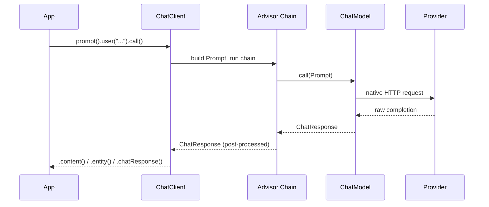

# 🧠 ChatClient & ChatModel (Spring AI)

> **One-line definition** — `ChatModel` is the low-level, provider-agnostic contract for calling an LLM; `ChatClient` is the fluent façade built on top of it that adds prompt building, advisors (memory/RAG/tool-calling), and typed response mapping.

---

## 📖 Definition

Both live in `org.springframework.ai.chat.*` and belong to Spring AI's **Model API** layer — the same layer that also standardizes embedding, image, audio, and moderation models across providers.

- **`ChatModel`** — an interface every provider implements (`OpenAiChatModel`, `AnthropicChatModel`, `OllamaChatModel`, ...). Contract: `ChatResponse call(Prompt prompt)` and `Flux<ChatResponse> stream(Prompt prompt)`. This is what makes swapping providers a config change instead of a rewrite.
- **`ChatClient`** — a fluent wrapper *around* a `ChatModel`, obtained from an autoconfigured `ChatClient.Builder`. Adds: prompt templating, an **advisor chain** (chat memory, RAG, tool-calling loop, logging), and typed response extraction (`.entity(MyRecord.class)`).

You reach for `ChatClient` by default. You drop to raw `ChatModel` when writing a custom `Advisor`, doing a batch job with no need for advisors, or isolating a bug ("is this the model or my advisor chain?").

---

## ⚙️ How It Works

**Request path:**
1. You call `chatClient.prompt().user(text).call()`.
2. `ChatClient` assembles a `Prompt` = `List<Message>` (`SystemMessage`, `UserMessage`, ...) + `ChatOptions` (temperature, maxTokens, model...).
3. The registered `Advisor` chain runs — e.g. `MessageChatMemoryAdvisor` injects prior turns, `ToolCallingAdvisor` (always auto-registered) prepares tool definitions.
4. The (possibly modified) `Prompt` hits `ChatModel.call(prompt)`.
5. The provider-specific implementation translates `Prompt` into native JSON, sends the HTTP request, and maps the response back into a portable `ChatResponse`.
6. `ChatResponse` = `List<Generation>` + `ChatResponseMetadata` (token usage, finish reason). Each `Generation` wraps an `AssistantMessage`.
7. `.content()` / `.entity()` / `.chatResponse()` unwrap that `ChatResponse` differently depending on what you asked for.

**Key architectural point**: `call()` on `ChatClient` does **not** trigger the network call by itself — it only selects sync-vs-streaming mode. The actual model invocation happens when you call `.content()`, `.chatResponse()`, or `.entity()`.

---

## 📍 Where We Find It

- Any REST endpoint that needs to answer with an LLM (`/ai/chat`, `/ai/summarize`, ...).
- Underneath every higher-level Spring AI feature: RAG advisors, tool calling, chat memory — they're all `Advisor` implementations sitting in the `ChatClient` chain, not separate mechanisms.
- Batch/offline jobs that call `ChatModel` directly, skipping the advisor overhead entirely.

---

## 🛠️ What We Use It For / What Uses It

- `ChatClient.Builder` — autoconfigured by Spring Boot once a `-starter-model-*` dependency is on the classpath (`spring-ai-starter-model-openai`, `-ollama`, `-anthropic`...).
- `SimpleLoggerAdvisor` — request/response logging at `DEBUG`, useful during development, dangerous unscrubbed in production (logs raw user input).
- `ToolCallingAdvisor` — auto-registered on every `ChatClient`, whether or not you pass `.tools()`.
- Testing: Spring AI's Testcontainers module can spin up a real local model (Ollama) or vector store for integration tests instead of mocking `ChatModel`.

---

## 🎯 Why It Matters — By Path

| Path | Relevance | Why |
|------|-----------|-----|
| 🔐 Ethical Hacking / AI Security | ⭐⭐⭐⭐ | `ChatModel` never lets the LLM touch your APIs directly — tool arguments and free-text output from the model must be treated as **untrusted input**, same as any user-supplied data, before it reaches a DB query, a tool call, or a log line. Prompt injection targets exactly this boundary. |
| 🤖 AI / ML Engineering | ⭐⭐⭐⭐⭐ | This is the foundation every other Spring AI feature (RAG, memory, agents) is built on. |
| 💻 Backend Dev | ⭐⭐⭐⭐⭐ | Same fluent-builder idiom as `WebClient`/`RestClient` — if you know those, `ChatClient` is familiar territory. |
| ⚙️ DevOps / Cloud | ⭐⭐⭐ | Token usage lives in `ChatResponseMetadata` — that's your cost-metering hook; `SimpleLoggerAdvisor` + Micrometer observability are the debugging/monitoring surface. |

---

## 💡 Example / Scenario

You're building the internal tool assistant for ONDA. A support agent asks `/ai/ask?q=...`. If you log the full request/response via `SimpleLoggerAdvisor` at DEBUG in production and that log ships to a shared aggregator, you've just leaked whatever the agent typed — which, on an airport ops system, could include passenger names or flight details. Treat `SimpleLoggerAdvisor` like you'd treat request/response logging on any auth or payments endpoint: fine in dev, scrubbed or disabled in prod.

---

## 🔁 Comparison Table

| Feature | `ChatModel` (raw) | `ChatClient` (fluent) |
|---|---|---|
| API style | `call(Prompt)` / `stream(Prompt)` | `prompt().user().call().content()` |
| Advisors (memory, RAG, tools) | ❌ manual | ✅ built-in chain |
| Typed output (`.entity()`) | ❌ manual JSON parsing | ✅ schema-generated + optional validation retry |
| Runtime option overrides | Full replacement of unset fields falls back to start-up config | `.options(Consumer<ChatOptions.Builder>)` — merges into current defaults |
| When to use | Custom advisors, batch jobs, debugging | Default choice for everything else |

---

## 🧩 Related Concepts

- [[02-prompts]] — prompt templates, `{placeholder}` syntax, `TemplateRenderer`
- [[03-chat-memory]] — `MessageWindowChatMemory`, `ChatMemory.CONVERSATION_ID` requirement
- [[04-tool-calling]] — `@Tool`, `ToolCallingAdvisor`, the model/tool trust boundary
- [[05-advisors]] — how memory/RAG/tools/logging all compose as `Advisor` implementations in the same chain
- [[06-rag]] — `QuestionAnswerAdvisor`, `RetrievalAugmentationAdvisor`

---

## 📌 TL;DR

- `ChatModel` = portable contract per provider. `ChatClient` = fluent façade + advisor chain built on top.
- `call()` is lazy — nothing fires until `.content()` / `.chatResponse()` / `.entity()`.
- `ChatResponse` → `List<Generation>` → `AssistantMessage`; `.getResult()` grabs the first candidate.
- `.entity()` is schema-as-instructions by default, not a hard constraint — use `.validateSchema()` for auto-retry.
- `ToolCallingAdvisor` is always auto-registered; `SimpleLoggerAdvisor` is opt-in and logs raw request/response — scrub before production.